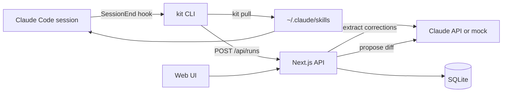

# KitForge — PRD

Sep 25, 2026 · @Donald Miller

## Overview

KitForge is a personal registry for Claude Code kits (skills) that versions every kit, captures feedback from each run, and turns that feedback into reviewed new versions. Launch kits: Idea-to-Build Kit, New Feature Kit, Debug Kit.

| Reference product | What we recreate | What we skip |
| --- | --- | --- |
| GitHub | File viewer, diffs, PR-style review with per-hunk accept/reject, releases + changelog | Branches, forks, merge conflicts, social features |
| npm | Semver versions, a CLI to pull a pinned version (`kit pull debug@1.3`) | Public registry, dependency trees, publishing to others |
| LangSmith / Braintrust | Feedback attached to runs, comparing metrics across versions | Tracing SDKs, eval datasets, hosted dashboards (functionality only, no code) |
| Linear | Triage inbox: tag, merge duplicates, dismiss | Projects, cycles, team workflows |

**The problem.** Kits get better only when you remember to hand-edit them after a bad run. Corrections live in chat history and get lost, so the same mistake repeats. There is no record of which kit version a project used, or whether an edit actually helped.

## Goals and non-goals

v1 closes the loop: run a kit, capture feedback automatically, ship a better version.

1. Store and browse kits with immutable, semver-numbered versions.
2. Install any version into Claude Code with one CLI command.
3. Capture a run report automatically at the end of every Claude Code session that used a kit.
4. Triage feedback in an inbox.
5. Generate an improvement proposal (a diff) from selected feedback, review it per hunk, publish it as a new version.
6. Compare versions on success and correction rates.

**Non-goals (v1)**

- Multi-user accounts, teams, sharing or permissions
- Public marketplace, discovery, ratings from other people, payments
- Auto-publishing without human review
- Running kits inside KitForge (Claude Code runs them)
- Branching or forking kit versions
- Mobile apps (responsive web is enough)
- Non-Claude-Code agents (Cursor, Codex and so on)

## Users and user stories

The user is one technical builder who writes kits and hands them to Claude Code to run unattended.

| # | As a user, I want to… | So that… |
| --- | --- | --- |
| U1 | Import an existing kit folder or zip | My current kits become v1.0 without retyping |
| U2 | Browse my kits and read their files | I can see what each kit tells Claude Code |
| U3 | Run `kit pull <name>[@version]` | The kit lands in `~/.claude/skills` ready to use |
| U4 | Have a run report sent automatically when a session ends | Feedback exists without me filling in forms |
| U5 | Add a quick manual note or rating to a run | I can record things the hook missed |
| U6 | Triage feedback: tag, merge duplicates, dismiss | Only real, distinct problems drive changes |
| U7 | Select feedback and ask Claude for an improvement | I get a concrete diff, not vague advice |
| U8 | Accept or reject each hunk of the diff | Nothing changes in a kit without my approval |
| U9 | Publish a new version with a changelog linked to feedback | Every rule in a kit has a traceable reason |
| U10 | Compare two versions' metrics | I know whether a change actually helped |
| U11 | Roll back to an earlier version | A bad release costs me one click |

## Functional requirements

Requirements are grouped by area; P0 = v1 must have, P1 = v1 should have, P2 = later.

**Kits and versions (K)**

| ID | Requirement | Priority |
| --- | --- | --- |
| K1 | Import a kit from a folder or zip containing `SKILL.md`; it becomes version 1.0.0 | P0 |
| K2 | Library screen: one card per kit with name, current version, run count, success rate | P0 |
| K3 | Kit detail: file tree plus rendered Markdown viewer for the selected version | P0 |
| K4 | Versions are immutable; every publish creates a new semver version | P0 |
| K5 | Version timeline with changelog per version | P0 |
| K6 | Diff any two versions of a kit, file by file | P1 |
| K7 | Set any earlier version as current (rollback) | P1 |
| K8 | Create a blank kit and edit files directly in the browser (manual version bump) | P1 |

**CLI (L)**

| ID | Requirement | Priority |
| --- | --- | --- |
| L1 | `kit pull <name>[@version]` writes the kit to `~/.claude/skills/<name>/` plus a `.kitforge.json` manifest (name, version, content hash) | P0 |
| L2 | `kit list` shows local kits, installed version and latest version | P0 |
| L3 | `kit hook install` adds a Claude Code `SessionEnd` hook that calls `kit report` | P0 |
| L4 | `kit report` finds which installed kits the session used, builds a run report and uploads it | P0 |
| L5 | `kit note "<text>" [--rating 1-5]` attaches a manual note to the most recent run | P1 |
| L6 | `kit push <folder>` imports a locally edited kit as a new version | P2 |

**Runs and feedback capture (R)**

| ID | Requirement | Priority |
| --- | --- | --- |
| R1 | A run records kit, version, project path, start/end time, outcome (success / partial / failed) | P0 |
| R2 | The report extracts **corrections**: each point where the user overrode, corrected or redirected Claude, as one feedback item with a quote under 300 characters | P0 |
| R3 | Extraction uses the Claude API with a fixed JSON schema; the trimmed transcript is sent only to the Claude API and is never stored | P0 |
| R4 | Run list per kit, newest first, with outcome and correction count | P0 |
| R5 | User can override a run's outcome | P1 |
| R6 | Test pass/fail counts are parsed from the transcript when present | P1 |

**Feedback inbox (T)**

| ID | Requirement | Priority |
| --- | --- | --- |
| T1 | Inbox lists untriaged feedback across all kits, newest first, filterable by kit | P0 |
| T2 | Actions per item: accept (queue for improvement), dismiss, tag | P0 |
| T3 | Merge duplicate items into one, keeping all source runs | P1 |
| T4 | Suggested duplicates highlighted automatically | P2 |

**Improve and review (I)**

| ID | Requirement | Priority |
| --- | --- | --- |
| I1 | "Improve" on a kit sends its current files plus accepted feedback to Claude and returns a proposal: find/replace edits shown as diff hunks, each with a one-line rationale citing feedback IDs | P0 |
| I2 | Review screen shows the diff per file; each hunk has Accept and Reject | P0 |
| I3 | Publish applies accepted hunks, bumps the version (minor by default, patch or major selectable) and writes a changelog entry linking each change to its feedback | P0 |
| I4 | Feedback used in a published version is marked resolved with that version number | P0 |
| I5 | Edit a hunk's text before accepting | P1 |
| I6 | Regenerate the proposal with an extra instruction | P1 |

**Metrics (M)**

| ID | Requirement | Priority |
| --- | --- | --- |
| M1 | Per version: run count, success rate, mean corrections per run | P0 |
| M2 | Compare screen: two versions side by side with those metrics | P1 |
| M3 | Recurrence check: flag feedback on a new version that matches feedback resolved in an earlier one | P2 |

## Non-functional requirements

KitForge runs locally, keeps transcripts on the machine, and must be fully testable without calling the real Claude API.

| Area | Requirement |
| --- | --- |
| Latency | Library and kit pages load in under 500 ms with 50 kits and 2,000 runs |
| Performance limits | Kit up to 50 files and 2 MB; transcript up to 5 MB trimmed to 150k tokens before extraction |
| Reliability | `kit report` never blocks or fails the Claude Code session: 10 s timeout, on failure it queues the report in `~/.kitforge/outbox/` and retries on the next run |
| Security | Localhost only (bound to 127.0.0.1); API key in `.env`, never sent to the browser |
| Privacy | Raw transcripts are never stored or uploaded anywhere except the extraction call; only extracted quotes (under 300 characters each) are stored |
| Deployment | `npm run dev` / `npm start` on the user's machine; single SQLite file at `~/.kitforge/kitforge.db` |
| Configuration | `.env`: `ANTHROPIC_API_KEY`, `KITFORGE_MODEL`, `KITFORGE_PORT` (default 4317), KITFORGE\_HOST, KITFORGE\_DB\_PATH, KITFORGE\_URL (where the CLI finds the app), KITFORGE\_REPORT\_TIMEOUT\_MS, `KITFORGE_LLM_MODE` (`real` or `mock`) |
| Testability | `KITFORGE_LLM_MODE=mock` returns scripted extraction and proposal fixtures; a small @smoke suite calls the real API; each stage is verified by Playwright specs plus a walkthrough with the playwright-headless MCP server; every interactive element has a `data-testid` |
| Accessibility | Keyboard-operable inbox (j/k to move, a/d to accept/dismiss) and diff review |
| Cost | Extraction under $0.05 per run and a proposal under $0.25 at default model pricing |

**Licensing**

| Project | Licence | Implication |
| --- | --- | --- |
| LangSmith, Braintrust | Proprietary | Copy functionality only, no code |
| Linear, GitHub UI | Proprietary | Copy interaction patterns only |
| `diff` (jsdiff) | BSD-3-Clause | Safe to use as a dependency |
| `react-diff-view` | MIT | Safe to use as a dependency |
| Next.js, Drizzle ORM, better-sqlite3 | MIT / Apache-2.0 | Safe to use |

## Technical architecture

A local Next.js app with a SQLite database serves the UI and a JSON API; a Node CLI connects Claude Code to it through a SessionEnd hook.

The CLI installs kits and reports runs; the API owns all LLM calls and storage.

### Stack

| Layer | Choice | Why |
| --- | --- | --- |
| App | Next.js 15 (App Router) + TypeScript | UI and API in one process |
| UI | Tailwind CSS + shadcn/ui | Fast, consistent components |
| Diff | `diff` (jsdiff) for generating/applying patches, `react-diff-view` for display | Proven unified-diff handling |
| Markdown | `react-markdown` + `remark-gfm` | Render SKILL.md and references |
| Database | SQLite via `better-sqlite3` + Drizzle ORM | Single local file, zero setup |
| CLI | Node + `commander`, shipped as `bin/kit` in the same repo | Shares types with the app |
| LLM | `@anthropic-ai/sdk`, model from `KITFORGE_MODEL`; mock adapter behind the same interface | Deterministic tests |
| Tests | Vitest (unit/API) + `@playwright/test` (E2E) | Tests-first build |

### Data model

| Table | Key columns | Notes |
| --- | --- | --- |
| kits | id, name (unique slug), title, current\_version\_id | Name is the CLI handle |
| kit\_versions | id, kit\_id, semver, parent\_version\_id, content\_hash, changelog\_md, created\_at | Immutable once written |
| version\_files | version\_id, path, content | Full snapshot per version |
| runs | id, session\_id, kit\_version\_id, project\_path, started\_at, ended\_at, outcome, outcome\_overridden, tests\_passed, tests\_failed | One row per kit used per session; (session\_id, kit) unique together |
| feedback | id, run\_id, kit\_id, kind (correction/note/rating), text, quote, rating, tags, status (new/accepted/dismissed/merged/resolved), merged\_into\_id, resolved\_in\_version\_id | The inbox |
| proposals | id, kit\_id, base\_version\_id, feedback\_ids, instruction, status (draft/published/discarded) | One active draft per kit |
| proposal\_hunks | id, proposal\_id, file\_path, find\_text, replace\_text, edited\_replace, rationale, feedback\_ids, decision (pending/accepted/rejected) | Reviewed one by one |

### Key interfaces

| Name | Input | Effect |
| --- | --- | --- |
| `POST /api/kits/import` | zip or folder upload | Creates kit + version 1.0.0 |
| `GET /api/kits/:name/files?version=` | name, optional semver | Returns files for pull (latest current if omitted) |
| `POST /api/kits/:name/current` | semver | Rollback / set current |
| `POST /api/runs` | session\_id, kit name, version, project path, times, trimmed transcript | Extracts corrections via LLM, stores run + feedback; idempotent on session\_id + kit |
| `POST /api/runs/:id/notes` | text, rating | Adds manual feedback |
| `PATCH /api/feedback/:id` | status, tags | Triage |
| `POST /api/feedback/merge` | ids\[\] | Merges into the first id |
| `POST /api/kits/:name/proposals` | feedback\_ids, instruction? | Generates a proposal with hunks |
| `PATCH /api/hunks/:id` | decision, edited\_replace? | Review one hunk |
| `POST /api/proposals/:id/publish` | bump (patch/minor/major) | New version, changelog, resolves feedback |
| `GET /api/kits/:name/metrics` | — | Per-version run count, success rate, corrections/run |
| LLM `extractRun(transcript)` | trimmed transcript | `{outcome, corrections:[{text, quote}], tests:{passed, failed}}` |
| LLM `proposeImprovement(files, feedback)` | current files, feedback items | `{edits:[{file, find, replace, rationale, feedback_ids}]}` |

### Rules that are easy to get wrong

- A proposal is always made against the kit's current version. If current changes before publish, publish is refused with `stale_proposal`.
- The LLM returns find/replace edits, never raw diffs; the server renders each edit as one diff hunk. An edit whose find text does not occur exactly once in its base file is dropped and counted, never shown.
- Version files are copied in full on publish; nothing ever edits an existing version.
- Kit detection in `kit report`: a kit counts as used only if the transcript shows Claude reading `~/.claude/skills/<name>/SKILL.md`; its version comes from that folder's `.kitforge.json`.

## Milestones

Six stages take KitForge from skeleton to the full run → feedback → new version loop; stage 5 proves the core promise.

| Stage | Scope (requirement IDs) | Done when |
| --- | --- | --- |
| 0 Skeleton | Repo, Next.js app, Drizzle migrations, `.env` validation, `GET /api/health`, mock LLM adapter with fixtures, Vitest + Playwright harness, all E2E specs written first | `npm test` runs; `/api/health` returns `{"ok":true,"llmMode":"mock"}`; E2E specs exist and fail for missing features only |
| 1 Library and viewer | K1–K5 | Importing the Debug Kit fixture zip shows a card "debug-kit v1.0.0"; opening it renders SKILL.md and lists every file |
| 2 CLI install | L1, L2 | With a temp HOME, `kit pull debug-kit` creates `skills/debug-kit/SKILL.md` and a `.kitforge.json` reading version 1.0.0; `kit list` prints `debug-kit 1.0.0 (latest 1.0.0)` |
| 3 Run capture | L3, L4, R1–R4 | `kit report` on the fixture transcript creates one run for debug-kit 1.0.0 with outcome "partial" and 2 corrections, visible in the kit's Runs tab; a second identical report creates nothing |
| 4 Inbox | T1, T2, L5, R5 | Both corrections appear in the Inbox; accepting one and dismissing the other leaves 0 untriaged; `kit note` adds a third item |
| 5 Improve and publish | I1–I4, M1 | Improve on 2 accepted items returns 2 hunks with rationales; accepting both and publishing creates debug-kit 1.1.0 whose SKILL.md contains the new rule, whose changelog links both items, and both items show "Resolved in 1.1.0"; `kit pull` now installs 1.1.0 |
| 6 Polish (P1) | K6–K8, T3, I5, I6, M2, R6 | Compare shows 1.0.0 vs 1.1.0 metrics side by side; rollback to 1.0.0 makes `kit pull` install 1.0.0; merging 2 items leaves 1 with both runs listed |

## Success metrics, risks and open questions

KitForge succeeds if kits measurably need fewer corrections after each published version.

**Metrics**

| Metric | Target |
| --- | --- |
| Runs with an auto-captured report | ≥ 95% of kit sessions |
| Correction extraction precision (items the user accepts or merges, not dismisses) | ≥ 70% |
| Mean corrections per run, version N+1 vs N | Down ≥ 25% after 10 runs on N+1 |
| Proposal hunks accepted without edits | ≥ 60% |
| Time from Improve to published version | Under 3 minutes |

**Risks**

| Risk | Likelihood | Mitigation |
| --- | --- | --- |
| Extraction flags normal back-and-forth as corrections | High | Strict schema with examples; dismiss is one keystroke; track precision metric |
| Kit detection misses sessions (skill loaded without a SKILL.md read) | Medium | Manual `kit note --kit <name>` fallback; log unmatched sessions |
| Proposals bloat kits with one-off rules | Medium | Prompt requires generalising and prefers editing existing rules over adding; show file size change per proposal |
| Hook breaks or slows Claude Code | Low | 10 s timeout, outbox retry, hook exits 0 always |
| Claude Code hook format changes | Low | Hook config written by `kit hook install`, one place to update |

**Open questions**

- [ ] Product name: "KitForge" is a placeholder.
- [x] Single user, local only (assumed). Decided: single user on localhost; team sharing is out of v1.
- [ ] Fresh build (assumed) vs reusing existing code of yours.
- [ ] Installed kits update only on `kit pull` (assumed), not automatically on publish.
- [ ] Which Claude model for extraction and for proposals (assumed one model via `KITFORGE_MODEL`).
- [ ] Should kits also support non-skill formats (the zip-style build kits this skill produces)? Assumed: any folder with a `SKILL.md`.

**References**

- [Claude Code hooks](https://docs.claude.com/en/docs/claude-code/hooks)
- [jsdiff](https://github.com/kpdecker/jsdiff)
- [react-diff-view](https://github.com/otakustay/react-diff-view)
- [Drizzle ORM](https://github.com/drizzle-team/drizzle-orm)
